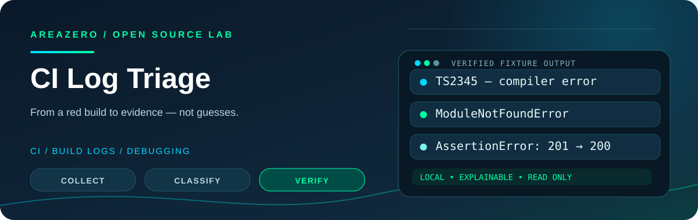
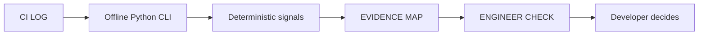

<p align="center">
  <a href="https://github.com/Kanompung1988/ci-log-triage"></a>
</p>

<p align="center"></p>

<h3 align="center">From a red build to evidence — not guesses.</h3>

<p align="center">A local, deterministic CI log signal triager with redacted, line-linked debugging hypotheses.<br>Built for <b>Claude Code</b>, <b>Codex</b>, and developers who want reproducible evidence instead of guesses.</p>

<p align="center">
<a href="https://github.com/Kanompung1988/ci-log-triage/actions/workflows/ci.yml"></a>
<a href="https://agentskills.io/specification"></a>

<a href="LICENSE"></a>

</p>

<p align="center"><a href="#quick-start"><b>Quick start</b></a> · <a href="#see-it-work"><b>See it work</b></a> · <a href="#install-as-an-agent-skill"><b>Install in Claude / Codex</b></a> · <a href="#tests--evidence"><b>Tests</b></a> · <a href="CONTRIBUTING.md"><b>Contributing</b></a> · <a href="SECURITY.md"><b>Security</b></a></p>

> [!IMPORTANT]
> **No magical claims.** This is an explainable, offline engineering helper—not a proof of safety or a fully autonomous repair agent. Test coverage and demo numbers refer to included **synthetic fixtures**. Humans remain responsible for interpreting the evidence.

## Why this exists

A failed CI job may contain hundreds of lines of setup output before the first useful error. This skill identifies familiar failure signatures, groups repeated noise and reports source line numbers plus small verification steps—without pretending to diagnose the root cause.

## At a glance

| Dimension | This project |
|---|---|
| Primary use | Compiler / dependency / assertion signals |
| Runtime | Python 3.10+, local files, no remote LLM calls |
| Agent interface | [Portable `SKILL.md`](SKILL.md), [Agent Skills specification](https://agentskills.io/specification) |
| Implementation | [`scripts/triage_ci.py`](scripts/triage_ci.py) |
| Regression suite | [`tests/`](tests/) |
| Demo inputs and reports | [`examples/`](examples/) |
| Ownership | Areazero Open Source Lab · [@Kanompung1988](https://github.com/Kanompung1988) |

## What it checks

| Signal or condition | Report behavior |
|---|---|
| TypeScript and common compiler failures | High signal patterns |
| Missing dependencies and import failures | High signal patterns |
| Test assertions and failing tests | Evidence grouping |
| Docker, disk, memory and runner signals | Safe next checks |
| Common token/password masking | Best-effort redaction |
| Line numbers on each finding | Auditable original evidence |

## Quick start

```bash
git clone https://github.com/Kanompung1988/ci-log-triage.git
cd ci-log-triage
python3 scripts/triage_ci.py --input examples/synthetic-ci.log --format json
```

The command above runs against **synthetic test fixtures stored in this repository**. No external Python runtime dependencies or credentials are required.

## See it work

### One noisy CI run, three actionable clues

```bash
python3 scripts/triage_ci.py --input examples/synthetic-ci.log --format json
```

**Verified fixture:** The included synthetic 9-line CI log produces 3 signal categories: TypeScript TS2345, a missing Python dependency, and a test assertion. `exit 0` means the **parser ran**, not that the build passed.

<details><summary><b>Inspect the sample evidence</b></summary>

- [Actual fixture: synthetic-ci.log](examples/synthetic-ci.log)
- [Actual fixture: ci-demo-report.md](examples/ci-demo-report.md)

Expected short summary:

```json
{"summary": {"signals": 3}}
```

</details>

## Install as an Agent Skill

**Claude Code**, from the root of the *project you want the skill to support*:

```bash
mkdir -p .claude/skills
git clone --depth 1 https://github.com/Kanompung1988/ci-log-triage.git .claude/skills/ci-log-triage
```

**Codex**, from your target project root:

```bash
mkdir -p .agents/skills
git clone --depth 1 https://github.com/Kanompung1988/ci-log-triage.git .agents/skills/ci-log-triage
```

Both tools discover a `SKILL.md` in the skill directory. Restart/reload the agent if a newly copied skill is not recognized. You can also install this folder in your personal skills directory rather than a project. No plugin key or cloud service is required. Reference: [open Agent Skills spec](https://agentskills.io/specification).

### Good triggers

- A GitHub Actions, GitLab CI or local build job failed and you have a log file
- You need evidence-linked hypotheses before changing a pipeline or dependency
- You want a safe offline summary for a debugging handoff

### When not to use it

- The raw log contains secrets or regulated data that have not been sanitized
- You only have a red status icon but no actual log
- You expect this tool to run commands from the log or apply fixes automatically

## Architecture



The agent's instruction contract is [SKILL.md](SKILL.md), implementation is readable Python, and the sample inputs live under [examples/](examples/). The script does not make network calls or modify the inputs.

## Project structure

```text
ci-log-triage/
├── SKILL.md                    # Agent triggers, workflow, limitations
├── README.md                   # This documentation
├── scripts/triage_ci.py          # Offline CLI
├── references/                 # Coverage and signal interpretation
├── tests/                      # Unit + packaging / brand checks
├── qa/smoke.py                 # Verified synthetic CLI example
├── examples/                   # Reproducible sample inputs/reports
├── assets/hero.svg             # Original project-specific illustration
├── assets/area-zero-logo-*.svg # Original logo bytes, unmodified
├── .github/workflows/ci.yml    # Python 3.10 / 3.12 matrix
├── CONTRIBUTING.md · SECURITY.md · BRAND.md
└── LICENSE                    # MIT (code only)
```

## Tests & evidence

Run locally:

```bash
python3 -m compileall -q scripts tests qa
python3 -m unittest discover -s tests -v
python3 qa/smoke.py
```

The [live GitHub Actions workflow](.github/workflows/ci.yml) runs these checks on **Python 3.10 and 3.12** for new PRs and changes to `main`. The current status is visible in the badge above. The original implementation was validated as part of [AREAZERO Skill Lab EP.01](https://github.com/Kanompung1988/agent-skills/pull/1); new per-repository CI is the authoritative record for the standalone package.

The **internal QA totals are not adoption metrics**, an independent external review, or an official `skills-ref` result. See [Evidence and limitations](docs/QUALITY.md).

## Safety & limitations

Regex-based evidence cannot establish the causal root of a failure. The redactor is heuristic and may miss secrets or personal data, so never publish raw or unreviewed CI logs.

The default CLI reads local files and writes no output file unless you request `--out`. No credentials are required and the implementation never deploys or applies fixes. Read the full [security policy](SECURITY.md) before processing real production inputs.

## Roadmap

- Add carefully scoped patterns with sanitized failing fixtures
- Highlight earliest failure versus downstream summary messages
- Offer optional explicit-output formats for approved issue trackers

We prioritize real, reproducible developer problems over creating a large catalogue of thin wrappers. Have a failing example? [Open an issue](https://github.com/Kanompung1988/ci-log-triage/issues) with an anonymized fixture and a proposed test.

## Credits · license · attribution

Created and maintained by **AREAZERO Skill Lab — ทำให้ AI เก่งขึ้นทุกวัน**. Source originated in the verified [2026-10-24 EP.01](https://github.com/Kanompung1988/agent-skills/pull/1), and moved into this dedicated public repository for focused collaboration. The scripts and documentation are licensed under [MIT](LICENSE); the official Area Zero marks are **not** MIT-licensed. Details: [BRAND.md](BRAND.md).

<p align="center"><b>Useful code. Reproducible tests. Honest claims.</b><br><sub>AREAZERO SKILL LAB · GitHub @Kanompung1988</sub></p>
